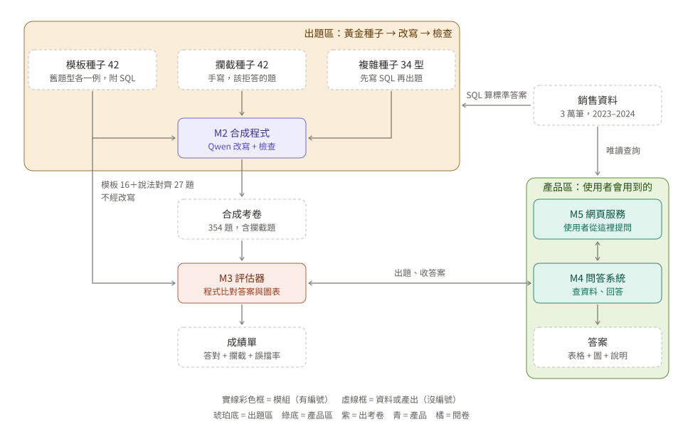

# Text-to-SQL Agent（本機 27B 模型）

用自然語言問銷售資料，系統寫 SQL、唯讀查詢、檢查答案是否對題，再回傳說明、完整資料表與圖表。
全部跑在本機單張 GPU 上的 27B 模型（Swift 1.5，Qwen3.8-27B 後訓練版，IQ3_XXS 量化）。

<!-- demo GIF: assets/demo.gif（錄製後加入） -->

## 設計重點：模型負責想，程式負責做

| 原則 | 做法 |
|---|---|
| 模型不決定流程 | 固定流程由程式控制（`Text2SQLWorkflow`），三個模型步驟都沒有 tools，不會「忘了呼叫查詢」 |
| 答案不能是模型編的 | 資料表與圖表由程式從實際查詢結果產生；模型只寫說明文字 |
| 查詢一定安全 | SQLite 唯讀連線 + authorizer，只允許單一 SELECT；5 秒、200 列、20 KB 上限，超限即失敗、不接受截斷結果 |
| 能執行 ≠ 答對 | 另一個模型步驟（reviewer）檢查 SQL 是否真的回答問題，例如「銷售量」不能用訂單數算 |
| 錯了要有限度地修 | 只有明確的驗證／執行錯誤才重試：SQL 最多 3 次、報告最多 2 次；逾時等傳輸錯誤直接停止 |
| 評分不靠 LLM judge | 主要評估以 SQLite 標準答案逐列比對；LLM judge 只當輔助，並人工核對 |

命名一眼可辨：`agent_` = LLM，`step_` = 程式一定執行，`tool_` = 模型自己決定呼叫。

## 流程

```text
使用者問題
  → agent_sql      （LLM）產生一條 SELECT
  → step_run_sql   （程式）唯讀執行；SQL 錯誤回饋給 agent_sql
  → agent_review   （LLM）檢查指標、篩選、時間、分組、排序是否對題；拒絕就回饋給 agent_sql（合計最多 3 次）
  → agent_report   （LLM）寫說明與圖表規格；格式或圖表欄位錯誤只重試這一步（最多 2 次）
  → step_publish   （程式）核對 reviewer 接受的就是這次的 SQL 與資料，產生完整資料表
  → step_draw_chart（程式）Plotly 繪圖
```



網頁的對話頁會即時畫出這張流程圖：圓角框是 LLM、方框是程式，綠色通過、紅色拒絕或失敗，
點任一步可看它的輸入、輸出與耗時，用來證明答案的每個數字都來自實際查詢。

模組編號（M1–M5）與名詞見 [docs/MODULES.md](docs/MODULES.md)。

## 成績

| 測試 | 結果 | 說明 |
|---|---|---|
| 離線測試 `verify_all.py` | 全數通過 | 真實 SQLite、假模型注入錯誤，不呼叫 LLM |
| Smoke 8 題 | **8/8** | 實際資料與圖表直接和 SQLite oracle 比對（[紀錄](docs/smoke-swift15.json)） |
| 模板考卷 132 題 | SQL 正確 **84.8%**（112/132） | 2026-11-07，Swift 1.5；與 2026-02 v1.0.0 的 84.1% 持平。未通過主因是 18 題模型 120 秒逾時 |
| 合成考卷 354 題 | 進行中 | 放行 228（含 102 題 CTE／視窗函數等複雜查詢）、攔截 126；以 SQLite 標準答案比對 |

細節、失敗分類與已知限制見 [docs/VALIDATION.md](docs/VALIDATION.md)。

## 測試資料怎麼來的

- **模板考卷**：17 個題型填入地區／國家／產品，標準答案用 pandas 從原始 CSV 計算，不經模型。
- **合成考卷**：參考「用合成資料測試 AI Guardrails」的方法，種子 → 本機模型改寫問法 → 規則、標籤、語意、SQL 對題
  四層檢查 → 不通過就把原因放回 prompt 重寫。每個種子的 SQL 都要和 pandas 的實作逐列一致才收。
  方法與被刷掉的實例見 [docs/SYNTHETIC_DATA_METHOD.md](docs/SYNTHETIC_DATA_METHOD.md)。

## 執行

需要一個 OpenAI 相容的模型端點（本專案用 llama.cpp router）。

```bash
uv sync --locked
uv run python scripts/run_planned_agent.py '南美 的總銷售額是多少？'
uv run streamlit run web_ui/app.py
```

模型端點用環境變數設定：

```bash
export LLAMA_CPP_MODEL=openai/swift15-27b-iq3-xxs
export LLAMA_CPP_API_BASE=http://127.0.0.1:18080/v1
export LLAMA_CPP_API_KEY=aaa
```

`openai/` 是 LiteLLM 的 transport 前綴，實際模型 ID 不含它。用 Docker 時，容器內的 localhost 是容器自己，
`LLAMA_CPP_API_BASE` 要設成容器連得到的位址（見 `docker-compose.prd.yml`）。

## 驗證指令

```bash
# 離線，不呼叫模型
uv run python scripts/verify_all.py

# 線上：8 題 smoke，與 SQLite oracle 比對
uv run python scripts/smoke_workflow.py --output docs/smoke-qwen27b.json

# 線上：模板考卷（LLM judge 輔助）與合成考卷（SQLite 比對，不用 judge）
uv run python eval/eval_e2e.py --limit 5
uv run python eval/eval_e2e.py --synthetic
```

`data/eval_manifest.json` 記錄 DB 與考卷的 SHA-256，避免拿舊標準答案評估新資料。

## 閱讀順序

1. [docs/HANDOFF.md](docs/HANDOFF.md)：目前狀態與下一步。
2. `src/text2sql/agents/planned_agent/qwen_workflow.py`：固定流程與兩處有限重試。
3. `contracts.py`、`prompts.py`：模型輸出格式與業務定義。
4. `tools.py`：SQLite 權限、結果上限、發布條件與繪圖。
5. `context.py`、`src/text2sql/runtime.py`：每回合清除舊結果、追問只帶上一題的問題與 SQL、完整消化事件串流。

## 已知限制

- 本機 27B 一次只處理一個請求；多年度逐月趨勢等長題目可能超過 120 秒。
- reviewer 與 planner 是同一個模型，可能有共同盲點；接受不代表語意上的數學保證，所以仍保留 oracle 評估。
- 目前沒有拒答機制：寫入請求、資料庫外問題只會因 SQL 失敗而沒有答案，不是主動拒絕。
- Session 用 InMemoryRunner，重啟後對話不保留。

## 歷史

早期另有一條 Codex CLI 路線，因服務對外、不適合用 CLI agent 子程序回應使用者，已於 2026-11-08 移除
（移除前的程式在 `96f9615`，兩條路線的比較見 [docs/ARCHITECTURE.md](docs/ARCHITECTURE.md)）。
最初的實作在 `fd66447`。

MIT License.
