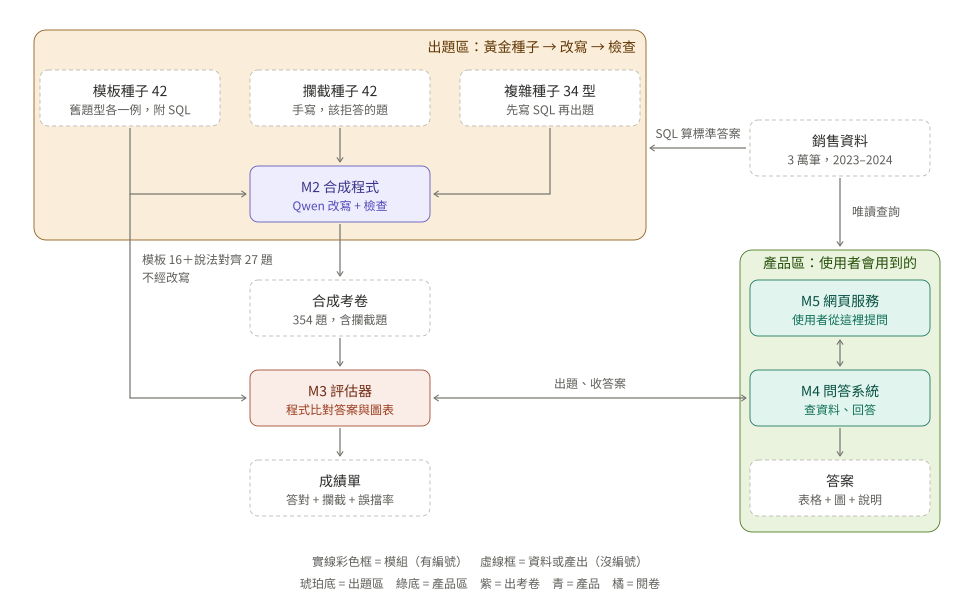

# 模組與名詞

討論本專案時統一使用這份文件的名詞。規則只有一條：**有編號的是模組（會做事），沒有編號的是資料或產出**。

## 模組

| 編號 | 名稱 | 做什麼 | 產出 | 主要位置 |
|---|---|---|---|---|
| M1 | 出題程式 | 把地區、國家、產品填進人寫的 17 個題型；用 pandas 從銷售資料算標準答案 | 模板考卷 | `scripts/generate_ground_truth.py` |
| M2 | 合成程式 | 拿種子讓 Qwen 改寫問法，再經規則、標籤、語意三層檢查，不通過就退回重寫 | 合成考卷 | `scripts/generate_synthetic.py`、`src/text2sql/datagen/` |
| M3 | 評估器 | 拿考卷出題給 M4，收回答案後評分 | 成績單 | `eval/eval_e2e.py`、`eval/synthetic.py` |
| M4 | 問答系統 | 寫 SQL、唯讀查詢、檢查是否對題、寫說明、畫圖 | 答案 | `src/text2sql/agents/planned_agent/qwen_workflow.py`、`src/text2sql/runtime.py` |
| M5 | 網頁服務 | 使用者在對話頁提問並轉給 M4；另有評估結果、GPU 監控、資料儀表板頁 | 網頁畫面 | `web_ui/` |

M4 內部流程（哪一步是 LLM、哪一步是程式）見 `docs/ARCHITECTURE.md`。

## 資料與產出

| 名稱 | 是什麼 | 由誰產生 | 位置 |
|---|---|---|---|
| 銷售資料 | 單表 `sales_data`，3 萬筆，2023–2024 | — | `data/global_sales_data.sqlite` |
| 模板考卷 | 132 題，含標準答案；54 題只是換地區別名 | M1 | `data/eval_set_v3.jsonl` |
| 黃金種子 | 從模板考卷挑出的 42 題，補上 SQL；SQL 與 pandas 兩條路算的答案必須一致 | `scripts/build_golden_seeds.py` | `data/seeds/golden_seeds.jsonl` |
| 攔截種子 | 42 題手寫的該拒答題目（寫入請求、資料庫外問題、閒聊等） | `scripts/build_guardrail_seeds.py` | `data/seeds/guardrail_seeds.jsonl` |
| 複雜種子 | 34 個題型，先寫 SQL 再出題 | `scripts/build_complex_seeds.py` | `data/seeds/complex_seeds.jsonl` |
| 合成考卷 | 354 題（放行 228、攔截 126） | M2 | `data/synthetic/runs/<時間>/dataset.jsonl` |
| 成績單 | 每題結果 + 彙總 | M3 | `eval/results/e2e_*/`、`eval/results/synthetic_*/` |
| 答案 | 表格 + 圖 + 說明 | M4 | 執行期 `state.final_answer` |

## 區塊

- **合成出題區**：三種種子 + M2。把模板考卷擴充成更多問法，並補上模板考卷沒有的攔截題與複雜題。
- **產品區**：M5 + M4 + 答案。使用者實際用到的部分；其他模組都為了測試它而存在。
  M3 直接把題目交給 M4，不經過 M5，所以成績單量的是 M4，不含網頁。

## 兩份考卷的評分方式

| 考卷 | 放行題 | 攔截題 |
|---|---|---|
| 模板考卷 | LLM judge 對照標準答案（judge 可能改錯，不能當真值） | 沒有攔截題 |
| 合成考卷 | M4 實際查出的資料列與 SQLite 標準答案直接比對，不用 judge | 整輪沒有任何 SELECT 成功執行就算擋下 |

## 已知缺口（2026-11-08）

- **M4 沒有拒答機制**：寫 SQL 的 agent 只能輸出一條非空 SQL，因此攔截題只有在 SQL 剛好連續執行失敗時才會通過，攔截率量不到真正的拒答能力。
- **M5 評估結果頁讀不到合成考卷的成績單**：頁面只讀 `e2e_results.json` 與舊版 `eval_results.json`，沒有讀 `synthetic_results.json`。
- 合成考卷的完整實測尚未執行。
